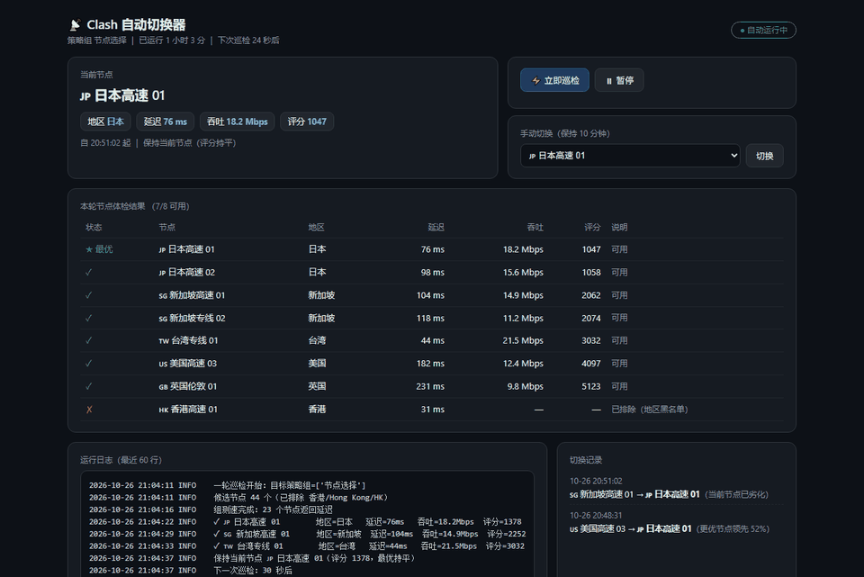

<div align="center">

# 📡 Clash Auto Switch

[English](README.md) | [简体中文](README.zh-CN.md)

**Auto-switch your Clash nodes before you feel the lag — with a live local dashboard.**

节点劣化自动切换，本地看板实时可视。

[](LICENSE)


[](https://github.com/GosuQuan/clash-auto-switch/actions/workflows/build-mac.yml)



*Live view: current node health / full-node throughput tests / auto-switch history / logs*

</div>

---

Still manually switching Clash nodes? Low ping but the page still won't load? This tool health-checks your proxy group every 30 seconds with **latency + real throughput**, switches away from degraded nodes automatically, **hard-blocks Hong Kong nodes, prefers low-latency regions like Japan/Singapore**, and ships with a local web dashboard.

## ✨ Features

- 🔄 **Automatic checks** — group-wide latency test via the mihomo external controller API every 30s (concurrency handled by the core, stable results)
- 📊 **Real throughput verification** — not just ping: each candidate gets a real download test, so "76ms but unusable" nodes get exposed
- 🌏 **Region strategy** — region blacklist (Hong Kong blocked by default) + region priority (Japan > Singapore > Taiwan > US > UK) + line-type preference
- 🪄 **Region round-robin sampling** — 8 nodes verified per round, spread across regions so high-priority regions always get tested even when group delay tests drop packets
- 🛡 **Anti-flapping** — 45% score-lead threshold + 120s switch cooldown + speed-test retry
- 📡 **Local dashboard** — live health results / switch history / logs in your browser; trigger a scan, pause, or manually switch
- 🖥 **System tray** — tray icon with notifications; right-click menu on Windows, menu bar on macOS
- 🔇 **No runtime deps** — single-file builds, no Python needed; never edits your Clash config, only calls the API

## 🎯 Why not just use built-in url-test?

Built-in strategy groups (`url-test` / `fallback`) answer *"what do I do when a node is dead?"*.
This tool answers *"what do I do when a node is still alive but already bad?"* — plus it treats your region and line preferences as first-class rules.

| Capability | **This tool** | Built-in `url-test` / `fallback` | Speed-test CLIs |
| --- | --- | --- | --- |
| Decision input | latency + **real throughput** | HTTP probe latency only | latency (some with speed) |
| Detects "alive but useless" nodes | ✅ (76ms / 0Mbps gets dropped) | ❌ always picked by url-test | ⚠️ tests but doesn't switch |
| Degradation awareness (works, but slow) | ✅ dual latency/throughput thresholds trigger a switch | ❌ fallback reacts only to full outages | ❌ |
| Region blacklist / priority | ✅ first-class, survives subscription changes | ❌ requires hand-editing provider configs | ❌ |
| Anti-flapping | ✅ 45% score-lead threshold + 120s cooldown + retries | ❌ re-picks by raw latency every interval | — |
| Unattended auto-switching | ✅ every 30s | ✅ | ❌ one-shot reports |
| Traceable switch reasons | ✅ every switch logged with its "why" in the dashboard | ❌ | — |
| Usable by non-CLI people | ✅ single file + tray + dashboard + notifications | ✅ (but the strategy is naive) | ❌ pure CLI |
| Non-invasive | ✅ REST API only | — | ✅ |

**Measured during development** (one sample window, your mileage will vary):

> The group delay test reported **32/32 nodes reachable**; real throughput testing found only **10** actually usable. One Japan node measured **76ms latency, 0 Mbps throughput** — a textbook "zombie" node that `url-test` would happily keep serving. Without retry logic, this tool itself flapped between two US nodes every 60s; the retry + cooldown + score-lead thresholds eliminated it.

## 🚀 Getting Started

> **Prerequisite:** [Clash Verge Rev](https://github.com/clash-verge-rev/clash-verge-rev) (mihomo core) running with the **External Controller** enabled.
> The tool reads the controller address and secret from Verge's config automatically (default `127.0.0.1:9097`).

### 🪟 Windows

**Option 1: ready-made executable**

1. Download `ClashAutoSwitch.exe` from [Releases](../../releases) (or build it yourself, see below)
2. Double-click → tray icon appears with a notification → dashboard opens at `http://127.0.0.1:38766`
3. Done. It now checks and switches every 30 seconds

**Option 2: run from source (Python 3.10+)**

```bat
pip install pystray pillow
python clash_auto_switch.py
```

**Windows tips**

| Need | How |
| --- | --- |
| Desktop shortcut | Just create a shortcut to the exe |
| Start at login | `Win+R` → `shell:startup` → drop the shortcut in |
| Stop | Tray icon → Exit |
| Antivirus flags it | Add the program folder to your AV's trust list (the exe extracts to a fixed `runtime-tmp/` dir, so most AVs leave it alone) |

### 🍎 macOS

```bash
git clone https://github.com/GosuQuan/clash-auto-switch.git
cd clash-auto-switch
bash build_mac.sh        # builds dist/ClashAutoSwitch.app and a DMG
open dist/ClashAutoSwitch.app
```

No Mac around? Use **GitHub Actions**: push this repo → Actions → *Build macOS App* → Run workflow → download `ClashAutoSwitch-macOS.dmg` from artifacts.

**macOS tips**

| Need | How |
| --- | --- |
| Gatekeeper blocks first launch | **Right-click the app → Open**; or `xattr -cr /Applications/ClashAutoSwitch.app` |
| Config / log location | `~/Library/Application Support/clash-auto-switch/` |
| Tray | Menu bar icon; allow notifications in System Settings |
| Sharing | `build_mac.sh` also produces `ClashAutoSwitch-macOS.dmg`, ready to send to friends |

### 🌐 The dashboard (same on both platforms)

Open `http://127.0.0.1:38766` after launch (auto-opens by default):

- **Current node card** — region / latency / throughput / score
- **Round results** — measured data for every tested node
- **Switch history / logs** — every automatic switch has a recorded reason
- **Manual switch** — pick any node from the dropdown; for the next 10 minutes auto-switching only reacts to hard failures, so it won't fight your choice

## 🧠 How it works

```
Every 30s:
 ├─ 1. Guard check — gstatic 204 through the current node
 ├─ 2. Group delay test — one API call, concurrency in the core
 ├─ 3. Region round-robin — pick the best of JP → SG → TW → US → UK, 8 nodes total
 ├─ 4. Throughput verification — switch to each node, download a Cloudflare file (retry once)
 ├─ 5. Score:
 │      score = region_rank×1000 + line_rank×50 + latency/1000×400 + 100/throughput×300
 │      (lower is better)
 └─ 6. Decide:
        current node failed / degraded   → switch now
        best node leads by ≥45%          → switch (120s cooldown)
        manual-hold period               → react to hard failures only
```

**Region detection** uses flag emoji and keywords in node names (日本/JP/Tokyo…). The **blacklist** matches names the same way (default `香港 / HK / Hong Kong`). Switching subscriptions requires no config change.

## ⚙️ Configuration (config.json)

```jsonc
{
  "controller": "127.0.0.1:9097",   // external controller
  "mixed_port": 7897,               // Verge mixed port (throughput tests go through it)
  "target_groups": [],              // groups to manage; empty = auto-pick
  "blocked_regions": ["香港", "Hong Kong", "HK"],
  "region_priority": { "日本": 1, "新加坡": 2, "台湾": 3, "美国": 4, "英国": 5 },
  "interval": 30,                   // check interval (seconds)
  "candidate_limit": 8,             // nodes throughput-tested per round
  "max_latency_ms": 1500,
  "min_speed_mbps": 0.8,
  "bad_latency_ms": 1200,           // current-node degraded thresholds
  "bad_speed_mbps": 3.0,
  "switch_threshold": 0.45,         // required score lead to switch
  "dashboard_port": 38766,
  "open_dashboard": true
}
```

## 📦 Build from source

```bash
pip install pyinstaller pystray pillow

# Windows
pyinstaller --clean -y --noconsole --icon icon.ico \
  --hidden-import pystray --hidden-import pystray._win32 \
  --add-data "icon.ico;." \
  --runtime-tmpdir ./runtime-tmp \
  --name ClashAutoSwitch clash_auto_switch.py

# macOS
bash build_mac.sh
```

> 💡 Keep `--runtime-tmpdir` on Windows: some antivirus products block exe files from extracting DLLs into `%TEMP%`.

## 🛠 Development

```bash
python clash_auto_switch.py --list     # list candidates / excluded nodes
python clash_auto_switch.py --once     # run a single check round
python clash_auto_switch.py --status   # show status
python clash_auto_switch.py --switch "node name"

# Regenerate the demo GIF for this README (mock data, no real subscription info)
python scripts/demo_server.py          # terminal 1
python scripts/make_gif.py             # terminal 2
```

## ❓ FAQ

<details>
<summary>Why are some low-latency nodes skipped?</summary>

Latency only proves the probe is reachable — not that the tunnel works. This tool trusts measured throughput: if the download can't run, the node is unusable.
</details>

<details>
<summary>My network hiccups during a check round?</summary>

Yes, briefly. Throughput verification actually switches the group to each node and downloads a few MB (~3–5s each). The best node is restored right after.
</details>

<details>
<summary>Does it work with original Clash / Clash Premium?</summary>

Anything with the external controller API should work in principle, but it's only tested with Clash Verge Rev (mihomo). The group delay endpoint `/group/{name}/delay` is mihomo-specific.
</details>

<details>
<summary>Does switching touch my subscription or config files?</summary>

No. It only calls the REST API to change the selected node of a group — exactly what you'd do by clicking in the Verge panel.
</details>

## ⚠️ Disclaimer

This project is for personal study and local network quality diagnostics only. Comply with the laws of your region and only use services you are entitled to. The project does not provide, bundle, or distribute any proxy nodes or subscriptions.

## 📄 License

[MIT](LICENSE) © 2026 clash-auto-switch contributors
